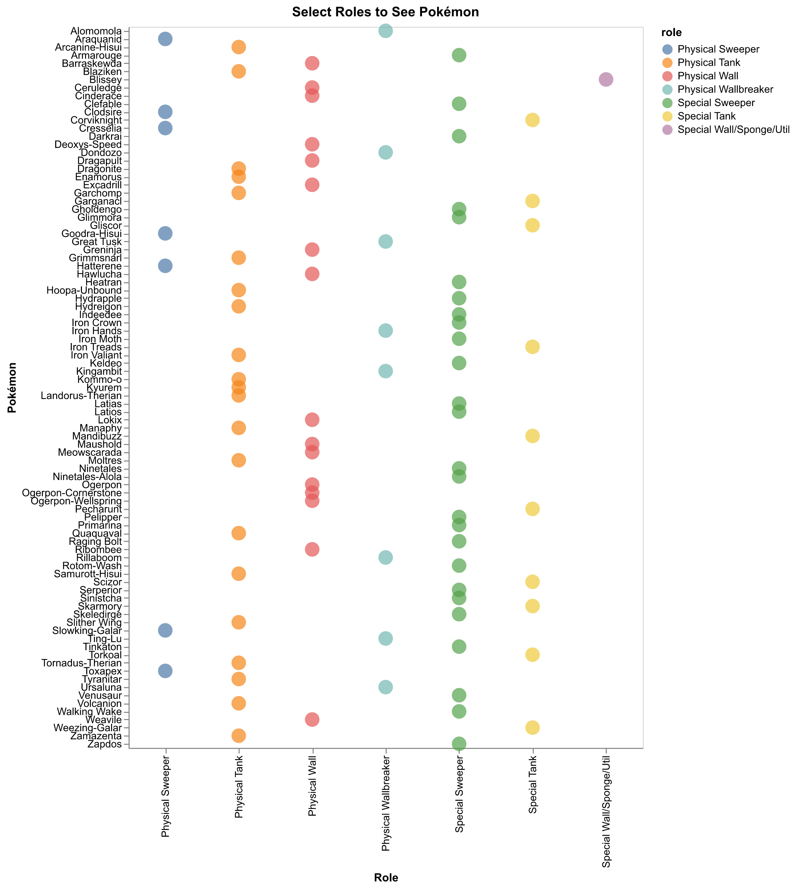

# Pokémon 6v6 Team Builder

## Setup

Install Python3 and the following libraries:

pandas, numpy, scikit-learn, matplotlib, altair, notebook

Pokedex: [Pokemon Showdown GitHub](https://github.com/smogon/pokemon-showdown/blob/master/data/pokedex.ts) converted to JSON

Smogon OU Usage: [Smogon 2026 1500+ Singles](https://www.smogon.com/stats/) converted to CSV

Run all cells and start building!

### Example

partial_team = ['Dragonite', 'Darkrai', 'Lokix']
completed_team = complete_team_knn(partial_team)
print(completed_team)

Or use the interactive drop-down to build it yourself!

The interactive dashboard is also available [here](https://nathaniel-designs.github.io/pokemon-ou-builder/)

You can select any of the Pokemon from OU as long as they're used by >1% of the players!